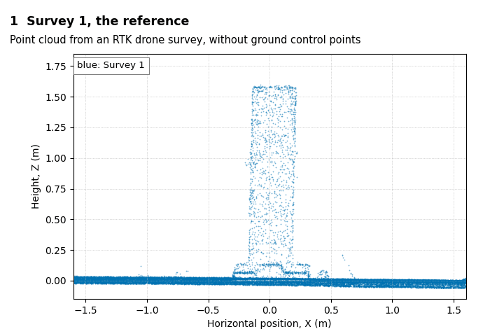

# Marker-free inclination and settlement monitoring from GCP-free RTK-UAV point clouds

This code estimates the displacement of the top of a slender structure, such as a chimney,
between two UAV surveys, without markers on the structure and without ground control points
(GCPs). Each survey is georeferenced directly from the RTK positions of the camera, so the
point clouds of different epochs lie in the same real-world frame up to a small offset. The
pipeline removes this offset by co-registering each later survey to the reference on the
stable area around the structure, then registers the structure by rigid ICP and reports the
displacement of its top-centre point. The horizontal component gives the inclination and the
vertical component the settlement.



*Surveys 1 and 4 of the study seen from the side. The offset in step 3 is drawn 20 times larger
than measured.*

It is the code of the paper *Marker-Free Inclination and Settlement Monitoring of Tall
Industrial Chimneys Using GCP-Free RTK-UAV Point Clouds: A Scaled-Model Feasibility Study*
by Hojune Ann, Ningji Huang and Ki-Young Koo (University of Exeter).

Results in the paper (1.6 m scaled chimney model, seven imposed tilt and settlement cases,
ground truth from ruler measurements):

- With RTK georeferencing only, the maximum absolute errors were about 1 cm (0.96 cm
  horizontally, 0.87 cm vertically).
- With co-registration on the stable area, the maximum absolute errors were 0.42 cm
  horizontally and 0.58 cm vertically, and the mean absolute errors 0.16 cm and 0.32 cm.

## Installation

Python 3.11 with

```
pip install -r requirements.txt
```

## Input

One point cloud per survey, georeferenced in metres with Z up (for example UTM easting,
northing and ellipsoidal or orthometric height), cropped to the same region of interest
around the structure. The region has to contain the structure, the ground around it and,
if possible, a few static objects. Supported formats: `.npz` (array `xyz`), text files with
X, Y, Z in the first three columns (`.txt`, `.csv`, `.xyz`, `.asc`; lines starting with
`//` or `#` are skipped) and `.ply` or `.pcd`.

The point clouds of the study are available from the corresponding author on reasonable
request. `extract_surveys.py` converts the CloudCompare file of the study (`Chimney.bin`)
into `survey_1.npz` ... `survey_8.npz`.

## Usage

Any reference and later surveys:

```
python run_pipeline.py survey_1.npz survey_2.npz survey_3.npz --out results.json
```

For every later survey it prints the displacement of the top-centre point (cm) with RTK
georeferencing only and after co-registration, and the offset of the survey relative to the
reference at the foot of the structure. `results.json` also holds the transformations, in
the local frame given by `origin`.

The results of the paper:

```
python extract_surveys.py Chimney.bin --out data
python reproduce_paper.py --data data --out results
```

`reproduce_paper.py` prints the rows of Table 5, the georeferencing offsets, the ground-plane
variant and the sensitivity to the stable area, and checks 45 of these values against those
printed in the paper. On the data of the study all 45 agree.

## Method

`pipeline.py` implements the four steps of Section 2.4 of the paper.

| Step | What it does | Settings |
|---|---|---|
| (i) Detection | RANSAC ground plane of the reference; least-squares ground plane of each later survey; DBSCAN on the points more than 0.30 m above the ground; the cluster with the largest vertical extent is the structure; cylinder fit through circle centres of ten slices; points within 3 cm of the cylinder | RANSAC threshold 1 cm, 2000 iterations; DBSCAN radius 5 cm, 20 points; ground of a later survey from points 0.8-2.0 m from the axis and within 3 cm of the reference plane, 3-sigma trimming |
| (ii) Co-registration | Points more than `r_min` horizontally from the foot of the axis (ground and static objects) of the later survey registered to the same area of the reference, 6 degrees of freedom, from the identity | point-to-plane ICP, `r_min` = 0.8 m, correspondence distance 5, 2, 1 cm |
| (iii) Registration | Reference structure above 0.30 m registered to the later structure above 0.15 m, from the translation between centroids | point-to-plane ICP, 5, 2, 1 cm, 50 iterations per stage, normals from 20 neighbours |
| (iv) Displacement | `d = T(p_top) - p_top`, with `p_top` on the axis at the 99.5th percentile of the axial coordinate | |

Without step (ii), the surveys are compared in the frames of their own RTK georeferencing.
Steps (iii) and (iv) assume that the structure moves as a rigid body. The co-registration
needs static features around the structure; objects that move between surveys should be
outside the region of interest or inside `r_min`.

The marker-free pipeline processed the eight surveys of the study in about 80 s on two CPU
cores.

## Files

| File | Content |
|---|---|
| `pipeline.py` | Steps (i) to (iv) and the ground-plane variant |
| `run_pipeline.py` | Command line for any set of surveys |
| `reproduce_paper.py` | Results of the paper and checks against the printed values |
| `extract_surveys.py` | Surveys of the study from the CloudCompare file |
| `ccbin.py` | Reader for CloudCompare BIN v2 files (groups, point clouds with colours, labels) |
| `docs/make_overview_gif.py` | The animation above, from Surveys 1 and 4 |

## License

MIT License (see `LICENSE`).
